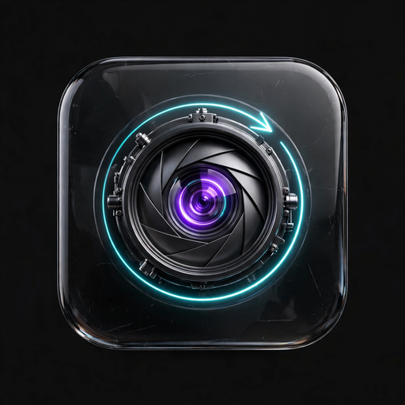
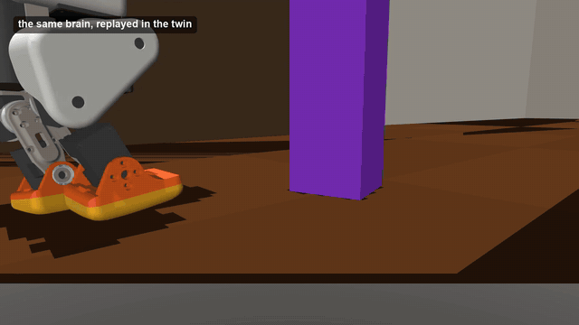
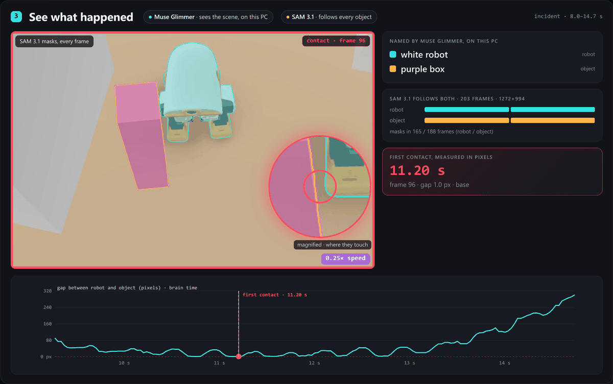
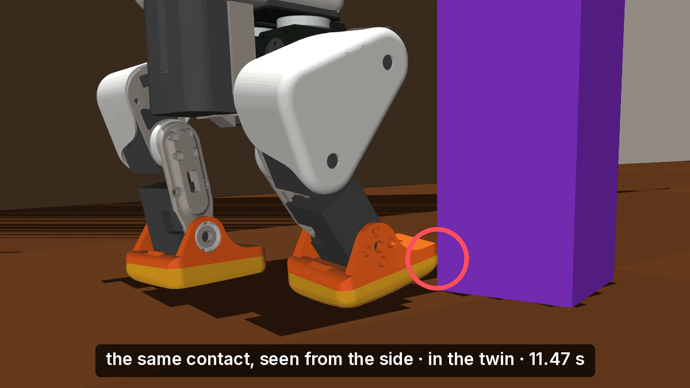
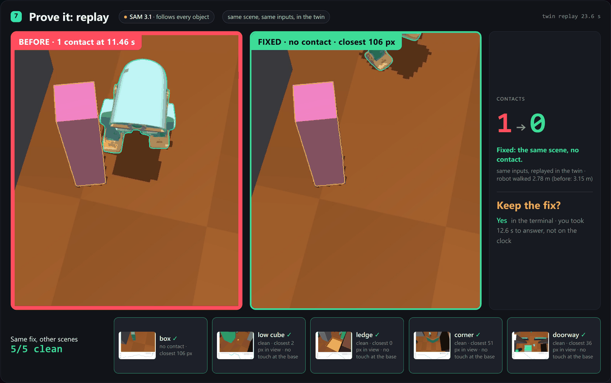
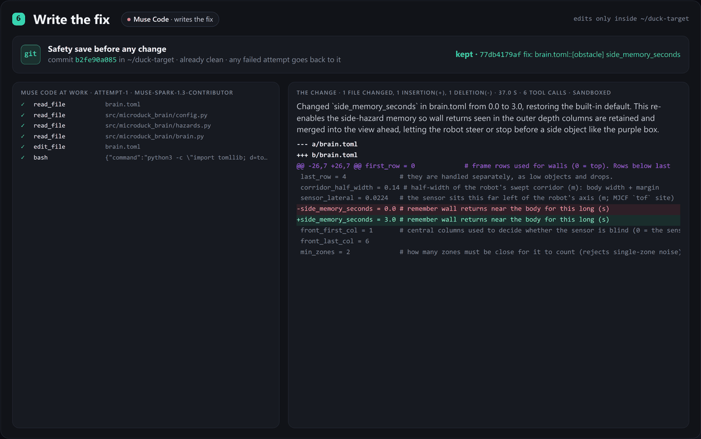

<p align="center"></p>

# BlinkFlow

[](https://github.com/samoxis/blinkflow/actions/workflows/judge-path.yml)

**Say it. Fix it. Prove it.**

**[See a real run, no install](https://samoxis.github.io/blinkflow/report/)**: the purple-box incident, from the snapshot to the proof. It is the static report of `examples/purple-box/`.

<p align="center"></p>

## For the judges (5 minutes)

| Criterion | What it shows | Where |
|---|---|---|
| **Impact** (30%) | Say what went wrong on screen, get a proven fix in the robot's code. 8/8 bugs fixed on a held-out pass: new seed, code frozen. 7 of the 8 repeat first-pass mutations; 1 is new. Live: contact in 5/5 runs before the fix, 0/5 after | [Results](#results), [Where this could go](#where-this-could-go-not-built-or-tested-yet) |
| **Use of Meta tooling** (25%) | One job per model. Muse Glimmer (open weights, on this PC) watches and names. SAM 3.1 tracks. Muse Wonder finds the cause. Muse Code fixes. Muse Voice Transcribe listens. Every call is logged | [How it works](#how-it-works), [`models.json`](examples/purple-box/models.json) |
| **Technical depth** (20%) | Distances from SAM 3.1's masks. A diagnosis whose citations are checked. An exact replay in a deterministic twin. Rollback and retry. A gate before each tool call | [`results/bug_suite.md`](results/bug_suite.md), [Safety](#safety) |
| **Demo** (25%) | The purple-box incident from the sentence to the proof, as a page anyone can open, and the live console | [The report](https://samoxis.github.io/blinkflow/report/), [The console](#the-console) |

**Open weights:** Muse Glimmer runs on this PC → [provenance](#muse-glimmer-on-this-pc--provenance).
**Try it in ~2 min, no GPU** → [quickstart](#try-it-in-2-min-no-gpu).

## What is new here

- **It watches pixels, not the simulator's insides.** BlinkFlow looks at the window, as the developer does. Plain measurements come first: SAM 3.1's masks become distances and a first contact. Only then does Muse Wonder look, and its answer is checked against what it was sent.
- **The proof is the same scene, played again.** A deterministic twin replays it exactly, and it is measured again on pixels. A fix that fails is undone and tried again. Then the person answers "Keep the fix?".
- **A referee the agent never sees, and a gate.** Results are scored from contact logs that BlinkFlow never gets. Every Muse Code tool call is checked first: one that names a path outside the target is blocked before it runs.

## Contents

[For the judges](#for-the-judges-5-minutes) · [What is new](#what-is-new-here) · [The robot](#the-robot-in-the-demo) · [How it works](#how-it-works) · [Why the Meta stack](#why-the-meta-stack) · [The code](#where-it-is-in-the-code) · [Results](#results) · [Try it in ~2 min](#try-it-in-2-min-no-gpu) · [Run the full loop](#run-the-full-loop-3060-min-gpu) · [Glimmer provenance](#muse-glimmer-on-this-pc--provenance) · [Limits](#limits) · [Pre-existing vs built](#pre-existing-vs-built-during-the-hackathon) · [Safety](#safety)

## The robot in the demo

[Microduck](https://github.com/pollen-robotics/microduck) is a small open-source biped robot by Pollen Robotics / Hugging Face. Two pre-existing layers move it:

- **The legs:** Pollen's walking policy, a neural network trained with reinforcement learning in a MuJoCo simulation. It turns "walk at this speed, turn at this rate" into steps.
- **The brain:** [microduck-brain](https://github.com/samoxis/microduck-brain), the author's own, picks those speeds from one 8×8 depth sensor facing forward. It walks ahead, steers away from what comes near, stops and turns in place at walls and boxes, turns out of corners, goes around low objects on the floor, keeps away from ledges, and remembers for a few seconds what it saw beside its body after it leaves the sensor's view.
- **The five scenes** test one rule each: the purple box (what passes beside the body), a low cube, a ledge, a corner, a narrow doorway.
- **The demo bug** is an earlier bug of the author's, put back: the brain judges "ahead" from the sensor's front columns only, and its side memory is off (`side_memory_seconds = 0.0`). The purple box leaves the sensor's view before the right leg has passed it, and the leg hits the box it should have steered around. In the example, Muse Code turns the memory back on (3 s).

## How it works

For people who write robot software and test it in a simulator: you say what went wrong on screen, BlinkFlow finds the cause in the robot's code, fixes it, and proves the fix on the same scene.

BlinkFlow watches a robot simulator the way you do: through the screen. When the robot does something wrong, you say what you saw. BlinkFlow rewinds to that moment, works out which part of the robot's program caused it, writes the fix, and plays the same scene again to prove the problem is gone. If the fix doesn't work, it undoes it and tries again.

What it films is the simulator's window on your screen, not a camera on the robot. It runs Meta's **open-weight Muse Glimmer on this PC**, so that window never leaves the machine until Glimmer raises a hand or you speak.

| Step | What happens | Meta model |
|---|---|---|
| Remember | The last 60 seconds of the simulator window are kept locally | — |
| Watch | Or nobody says anything: about once a second the newest frame is checked locally for a robot touching, nearly touching, fallen or stuck; a raised hand is confirmed on pixels before the loop starts, and the moment comes from BlinkFlow's own clock (`results/watcher.md`) | Muse Glimmer (local), SAM 3.1 |
| Listen | Hold F9 (or, with `--tap-to-talk`, tap the arm of the Ray-Ban Meta glasses, and tap again when done) and say what you saw ("three seconds ago its right leg hit the purple box"), or type it; the moment is the key press on BlinkFlow's own clock minus the time you said; the sentence is read locally (`results/voice.md`) | Muse Voice Transcribe, Muse Glimmer (local) |
| See | Objects in those seconds are named locally and then followed pixel by pixel; the masks become measurements (distance between objects per frame, first contact) | Muse Glimmer (local), SAM 3.1 |
| Understand | Key frames + measurements + time-aligned logs + the robot's code → the cause, plus a plain-language explanation. Every claim cites its source: a key frame, a measurement, a log tick or a code line, and the answer is checked against what was sent (the file, function and lines exist; the cited frames and ticks exist) | Muse Wonder |
| Fix | A coding agent patches the code inside its sandbox; a git commit is taken first | Muse Code (Python SDK) |
| Prove | The same scene, replayed exactly in a deterministic twin, and checked again on pixels; failed fixes are rolled back and retried. For the demo incident, then confirmed on the live simulator (`results/live_check.md`) | SAM 3.1, Muse Code |

<p align="center"></p>
<p align="center"><em>See: SAM 3.1 follows both objects on every frame of the live window; the gap in pixels gives the first contact, 11.20 s (the example run, <a href="examples/purple-box"><code>examples/purple-box/</code></a>).</em></p>
<p align="center"></p>
<p align="center"><em>From above, the foot is hidden under the robot; SAM 3.1 counts contact when the masks come within 2 px. The side view shows the touch.</em></p>

## Why the Meta stack

- **Muse Glimmer runs locally, with open weights.** It watches all the time, 0 tokens billed, and the frames it watches never leave the PC unless it raises a hand or you speak.
- **SAM 3.1 turns video into masks across frames,** and the distance between the masks is the measurement: no model eyeballs it.
- **Muse Wonder reasons over frames, log and code at once; Muse Code edits in a sandbox, behind the gate.** The whole chain, from watching to the fix, is one ecosystem.

**Works on any screen.** BlinkFlow only watches pixels, through GPU screen capture (DXGI Desktop Duplication + NVENC), of the window named by the sidecar's `--title`; there is no plugin in the simulator. The pixel part should apply to any simulator (Isaac Sim, Gazebo, CARLA, Unreal), but it has not been tested on them. The replay proof needs a simulator that can replay a scene deterministically.

## Where it is in the code

- **The 60 s buffer:** [`sidecar/capture.py`](sidecar/capture.py) on Windows keeps the ring of 1 s segments; [`blinkflow/capture.py`](blinkflow/capture.py) (`Sidecar`) starts it and cuts snapshots from WSL.
- **Muse Glimmer:** [`blinkflow/models.py`](blinkflow/models.py) (`glimmer`), called to name objects in [`see.py`](blinkflow/see.py) (`name_objects`), describe key frames in [`diagnose.py`](blinkflow/diagnose.py) (`build_frames`), read the sentence in [`voice.py`](blinkflow/voice.py) (`parse`) and watch in [`watch.py`](blinkflow/watch.py) (`Watcher`).
- **SAM 3.1 and the contact:** [`blinkflow/sam.py`](blinkflow/sam.py) (`track`) calls it, [`maskcodec.py`](blinkflow/maskcodec.py) decodes the masks, [`see.py`](blinkflow/see.py) (`gap`, `base_of`, `measure`) turns them into distances and a first contact.
- **Muse Wonder and the citation check:** [`blinkflow/diagnose.py`](blinkflow/diagnose.py) (`ask`, `check`).
- **Muse Code and the gate:** [`blinkflow/fix.py`](blinkflow/fix.py) (`muse_code`, `gate`, `audit`) and the PreToolUse hook [`muse-gate/hooks/pre_tool_use.py`](muse-gate/hooks/pre_tool_use.py).
- **The twin:** [`blinkflow/twin.py`](blinkflow/twin.py) (`Twin`, `Video`), the scenes in [`blinkflow/scenes/`](blinkflow/scenes).
- **Proof, rollback, "Keep the fix?":** [`blinkflow/prove.py`](blinkflow/prove.py) (`replay`, `verdict`, `control`); [`blinkflow/fix.py`](blinkflow/fix.py) (`fix`, `undo`, `terminal_ask`).

## Results

Measured during the hackathon; each number links to the file it comes from.

| What | Result | Source |
|---|---|---|
| Bug suite, stratified by layer (11 mutations drawn with a sealed seed, 8 gave an incident); blind to the mutation; perception rules were revised between passes | **5/8 on the first pass, 8/8 on the third**: incidents gone, control clean in all five scenes. Changes on the mutated line: **5/8 on the first pass, 6/8 on the third** | [`results/bug_suite.md`](results/bug_suite.md) |
| Same suite, held-out pass: a new seed, the code frozen, one pass, no reruns. 7 of the 8 kept bugs are a first-pass mutation with the same value; 1 is new | **8/8**: incidents gone, control clean in all five scenes. Changes on the mutated line: **7/8** | [`results/bug_suite.md`](results/bug_suite.md#held-out-pass-oct-28) |
| First suite (6 bugs), blind to the mutation, one pass | 6/6 fixed; Muse Wonder's cause on the mutated line in 5/6 | [`results/bug_suite.md`](results/bug_suite.md) |
| Live simulator, the demo incident, 20 s per run | contact in **5/5** runs without the fix, **0/5** with it (an earlier pass, with a CPU-heavy job beside it: 3/5, 0/5) | [`results/live_check.md`](results/live_check.md) |
| Seen → fixed and verified (machine time) | **135.8–234.0 s** over 10 purple-box loops, median 169.2 s; the spread is mostly Muse Wonder (55–120 s) | [`results/loop_times.md`](results/loop_times.md), [`results/quick_loop.md`](results/quick_loop.md) |
| Control after the fix, on pixels | **5/5 scenes clean, all 5 measured** (the 166.4 s run); the twin's log agrees | [`results/loop_times.md`](results/loop_times.md), [`results/console/`](results/console) |
| Watcher (nobody speaks) | **0 false alarms** in 16 runs without an incident; **14/17** incidents caught. Optimistic: the suite gave Glimmer a look every 0.97 s, live beside the simulator it is ~1.45 s | [`results/watcher.md`](results/watcher.md) |
| Voice | **5/5** TTS sentences heard, read and seen; 1 real spoken run (Ray-Ban Meta glasses, F9): transcribed, read, seen, fixed ([`examples/purple-box/`](examples/purple-box)) | [`results/voice.md`](results/voice.md) |
| Pixel rule against ground truth | 92 saved looks re-measured: 60/64 incidents caught, false alarms 1 → 0 after one correction | [`results/control.md`](results/control.md) |
| Cost of one loop (model calls) | **$0.88** for the profiled loop; $0.34–$1.71 over the 10 runs (measuring the four control scenes adds SAM 3.1; replies from the cache cost $0) | [`results/quick_loop.md`](results/quick_loop.md), [`results/loop_times.md`](results/loop_times.md) |

Every run writes a `models.json`: each model call with the model, where it ran (this PC, Meta, Baseten, the cache), tokens or frames, seconds and cost. Cost details (the SAM 3.1 cache, Muse Code's model, `tools/spend.py`): [`docs/RUNNING.md`](docs/RUNNING.md#cost).

<p align="center"></p>
<p align="center"><em>Prove it: the same scene replayed before (red) and after the fix (green), measured on pixels: contacts 1 → 0. Each replay is shown at its own moment: the first contact at 11.46 s, and with the fix the closest approach, 106 px, where the robot stops and turns away. "Keep the fix?" was answered yes.</em></p>

## Try it in ~2 min, no GPU

A recorded live run of the demo incident is in [`examples/purple-box/`](examples/purple-box): the 60 s snapshot, the sentence, the evidence, Muse Wonder's diagnosis, both answers, Muse Code's change, the replays before and after, the control scenes and the model calls. No GPU, no simulator, no key. A person said the sentence through the microphone of Ray-Ban Meta glasses (push-to-talk, F9; [`said.wav`](examples/purple-box/said.wav)), Muse Voice Transcribe wrote it down, and the same person answered yes to "Fix it?" (in the console, after 7.5 s) and to "Keep the fix?" (in the terminal, after 12.6 s).

**1. The report.** Python 3 (tested on 3.12), standard library only:

```bash
git clone https://github.com/samoxis/blinkflow && cd blinkflow
python3 -m venv .venv && . .venv/bin/activate
python3 -m blinkflow.console report examples/purple-box/events.jsonl --out report
```

Open `report/index.html` over a local server that answers byte-range requests, since the replays seek in their videos (`python3 -m http.server` does not, and they snap back to the start); the console's own server does, on the same example: `python3 -m blinkflow.console serve --events examples/purple-box/events.jsonl --port 8000`, then http://localhost:8000. Either way: the whole loop step by step, the masks, the distance to first contact, the cause with its key frame, log row and code line, the replay before | after, the clock and the bill.

**2. Measure it again.** The contact is re-derived from SAM 3.1's saved replies, offline (needs `ffmpeg`):

```bash
pip install -r requirements-judge.txt
cp -r examples/purple-box /tmp/pb
python3 -m blinkflow.see /tmp/pb/window/snapshot.json --out /tmp/pb/window/evidence --reuse
```

`/tmp/pb/window/evidence/evidence.json` comes out identical to `examples/purple-box/window/evidence/evidence.json` (first contact, closest gap, the gap in every frame) except for the two paths it names. It writes into the evidence folder, hence the copy.

**What needs a key.** Nothing above. Asking the models again does: SAM 3.1 and Muse Wonder need `MODEL_API_KEY` (Meta Model API), a diagnosis with Muse Spark needs `BASETEN_API_KEY` (Baseten), and both also need the robot's code. Keys are read from the environment or `~/.config/blinkflow/env`, never from the repo.

## Run the full loop (~30–60 min, GPU)

The loop itself on a new machine: BlinkFlow sees the incident, Muse Wonder finds the cause, Muse Code fixes the target, the twin replays the scene and SAM 3.1 checks it again. Step by step in [`docs/RUNNING.md`](docs/RUNNING.md):

1. Linux or WSL2, Python 3.12, `ffmpeg`, an NVIDIA GPU that holds Muse Glimmer (Ollama), the Muse Code CLI, `MODEL_API_KEY`.
2. `pip install -r requirements.txt`, then `python3 -m blinkflow.gate install`.
3. The target, `python3 tools/make_target.py ~/duck-target`, and Pollen Robotics' simulator with the demo scene ([`blinkflow-demo-scene`](https://github.com/samoxis/microduck_rl/tree/blinkflow-demo-scene)).
4. One loop on the purple box, from the recorded clip (no sidecar) or live (Windows 11 + WSL2).

Checked on Oct 28 from a fresh clone, a new venv and a target made by `tools/make_target.py` (same files as the one every run used): the purple-box loop, without the SAM cache, fixed it in attempt 1, contacts 1 → 0, in 167.3 s for **$0.83** ([`results/fresh_setup.md`](results/fresh_setup.md), which also says what was not redone from scratch).

## Muse Glimmer, on this PC — provenance

Glimmer is the open-weight model that names objects, describes key frames and reads the person's sentence, on an RTX 4090 through Ollama. To check that without this PC, [`examples/purple-box/`](examples/purple-box) carries:

**The model:** `muse-glimmer`, 27.9B, quantization **Q4_K_M**, projector clip 1.9B, served by Ollama 0.40.11, digest `de878ce33ad8`. The weights are Ollama's public library model [`muse-glimmer:30b-q4_K_M`](https://ollama.com/library/muse-glimmer) (also its `latest`), unchanged: the public manifest's SHA-256 is that digest, and its model and projector layers are the SHA-256 of the two weight files on this PC.

- [`glimmer-model.txt`](examples/purple-box/glimmer-model.txt): `ollama show muse-glimmer` on this PC, the SHA-256 of both weight files, the public manifest, and the one `curl | sha256sum` that checks it without a GPU.
- [`models.json`](examples/purple-box/models.json): every model call of the run. Glimmer's ten are `muse-glimmer`, `local`, with tokens in and out and seconds (the sentence, the names, four key frames, the names in four control scenes). Of the 56 SAM 3.1 calls, 6 were paid ($0.13 of the run's $0.50) and 50 are `cached, $0`, each with the hash of the video bytes, concept and parameters it answers.
- [`provenance.txt`](examples/purple-box/provenance.txt): Glimmer's ten calls with their times and tokens, and Ollama's own answer during the run (`/api/ps`, the `glimmer.vram` event in `events.jsonl`): `muse-glimmer`, 16.7 GB, all in VRAM, context 8192, Q4_K_M. No `ollama ps` / `nvidia-smi` sampler ran beside this run; an earlier run of the same example, sampled every ~3 s with both, is at [`e9b88d8`](https://github.com/samoxis/blinkflow/blob/e9b88d8/examples/purple-box/provenance.txt). Every `voice live` run now writes these samples itself, from start to end, into its own `provenance.txt`.
- [`glimmer.jsonl`](examples/purple-box/glimmer.jsonl): Glimmer's raw replies from the run, each with what it was asked and the image it saw.

`python3 tools/pack_example.py <run>/events.jsonl examples/<name>` packs any run the same way: paths made relative to the example, the home folder written as `~`, no keys, and never the scorer's ground truth.

## The console

A local page that shows the loop live, one step at a time, with the model behind each step, from the last 60 seconds rewinding to the moment to the replay before | after, the clock and the bill. "Fix it?" and "Keep the fix?" can be answered there or in the terminal. `python3 -m blinkflow.console serve` (http://localhost:8777); the other commands (the static report, the film mode, the teaser, the side shot) are in [`docs/RUNNING.md`](docs/RUNNING.md#the-console).

<p align="center"></p>
<p align="center"><em>Write the fix: a safety commit first, then Muse Code's tool calls and its one-line change, kept as <code>77db417</code>.</em></p>

## Where this could go (not built or tested yet)

BlinkFlow needs three things: a screen, a log and a folder of code. Only the deterministic twin and the target are specific to the duck; the rest of the loop is not, so it could serve:

- **Warehouse and delivery robots**, tested every day in simulation before they touch a real shelf.
- **Home robots**, like a vacuum that keeps getting stuck under the same sofa.
- **Open-source robots for hobbyists and schools** (Microduck, LeRobot arms, Reachy), whose owners are not robotics experts.
- **Game characters** that walk through walls or get stuck in doorways: also pixels, logs and code.

On a real robot the proof changes: the real world never repeats exactly, but the robot's recorded sensor log can be replayed through the fixed brain ("with exactly what it saw, would it turn now?"), then checked in simulation, then on the robot, and only with a person's "Keep the fix?".

## Limits

- **The twin is not the live simulator.** It starts the robot standing (no sit-to-stand boot) and re-states robotd's controller in Python, so robotd itself is bypassed.
- **The live simulator is not deterministic.** Four wall clocks run it, so the same brain does not walk the same path twice. That is why the proof is double: exact in the twin, then 5 runs on each side live.
- **Muse Wonder varies.** The same evidence gives different lengths of answer (4.7k–9.1k output tokens), and that alone moves the loop time by up to ~50 s; its cause is not always on the mutated line ([`results/bug_suite.md`](results/bug_suite.md)).
- **The watcher confirms after the fact,** a median 19.5 s after the incident (13–52 s): it is a safety net, not a brake.
- **"Stuck" has no real case.** The watcher checks for it, but no run has had a robot stuck.
- **One real spoken run so far:** the example's sentence was said through Ray-Ban Meta glasses (Bluetooth, F9) and transcribed correctly, one word doubled. The 5-sentence accuracy table is still from TTS; how far people's "N seconds ago" lands has one data point.

> Built during the [Meta Global AI Developer Hackathon](https://cerebralvalley.ai/e/meta-ai-developer-hackathon), Oct 26 – Nov 4, 2026. Indie Developer track, theme: Push the Frontier.
> The build log is in [`DEVLOG.md`](DEVLOG.md).

**New vs pre-existing:** everything in this repo was written after the kickoff on Oct 26, 2026; the robot, its simulator and its brain existed before — see [Pre-existing vs built during the hackathon](#pre-existing-vs-built-during-the-hackathon).

## Pre-existing vs built during the hackathon

The rules ask entrants to separate earlier work from new work. **Everything in this repository was written after the kickoff session on Oct 26, 2026.**

Existed before, used only as the test target, not part of this repo:

- [microduck-brain](https://github.com/samoxis/microduck-brain), an autonomy layer for the open-source Microduck biped (Apache-2.0), by the same author. BlinkFlow works on a clean copy of it (no README, no tests, no history, hint comments rewritten), so it cannot read the answer.
- The Microduck MuJoCo simulation and walking policies by [Pollen Robotics / Hugging Face](https://github.com/pollen-robotics/microduck) (Apache-2.0), and a recoloured demo scene.
- The recoloured demo scene with the purple box, the hook that shows the simulator in the browser (Viser) and the camera-direction script that films it (all Oct 22). Published unchanged, after the kickoff and labelled as pre-existing, on the branch [`blinkflow-demo-scene`](https://github.com/samoxis/microduck_rl/tree/blinkflow-demo-scene) of the author's `microduck_rl` fork: `scene_demo.xml`, `apartment_demo.xml`, `duck_viser_hook.py` + `.pth`, `duck_cam_director.py` and the incident's camera script `shots_incident.json`.
- The demo bug in the brain: the author's commit "demo: reintroduce finding 6" (Oct 22), never pushed. `tools/make_target.py` re-states it as text edits.
- The script that first made the target (strip the README, tests and hint comments). Not in this repo. It was started before the kickoff (Oct 26, 14:42) and its list of hint comments was last edited at 19:32 that day. **`tools/make_target.py` replaces it: rewritten from scratch on Oct 28, no code copied**, and it makes the same target file for file.
- Preparation tests made before the kickoff on Oct 26: a first API call, SAM 3.1 tracking on an old clip, a headless Muse Code session, a Muse Glimmer test and a prototype screen buffer. None of that code is included; the buffer was rewritten from scratch here.

## Honesty notes

- The simulator's own contact log is never given to BlinkFlow. It is used only as ground truth to score whether a fix worked.
- The twin loads the scene to simulate it; perception, diagnosis and the fix receive only pixels, the brain's own log and the code — never the contact log, truth.json or the scene geometry.
- Results are measured during the hackathon, on BlinkFlow's own fixes, including bugs injected blind into the robot's code.
- Every incident report lists each model call: model, where it ran, tokens.
- Speed-ups in the demo video are labelled on screen.

## Safety

Muse Code runs under `muse serve`'s default sandboxed profile, which does not stop a read or a write outside the target, so a PreToolUse hook (`muse-gate/`, `python3 -m blinkflow.gate install`) blocks any tool call that names a path outside the target before it runs. Every fix starts from a git commit; BlinkFlow asks "Fix it?" before Muse Code writes and "Keep the fix?" after the proof, and a no rolls the change back. How it was measured, and how to undo a kept fix: [`docs/SAFETY.md`](docs/SAFETY.md).

## Credits and licence

The icon was made with Meta's Muse Image; provenance in results/icon/.

The deterministic twin (`blinkflow/twin.py`) is new code, but the physics, the scenes, the depth sensor and the walking policies it runs are imported from [Pollen Robotics' Microduck](https://github.com/pollen-robotics/microduck) (`microduck_rl`), not copied.


Apache-2.0 (see `LICENSE`). Microduck and its simulation are by Pollen Robotics and Hugging Face, Apache-2.0. Code in this repository is written with AI coding assistants under the author's direction.
