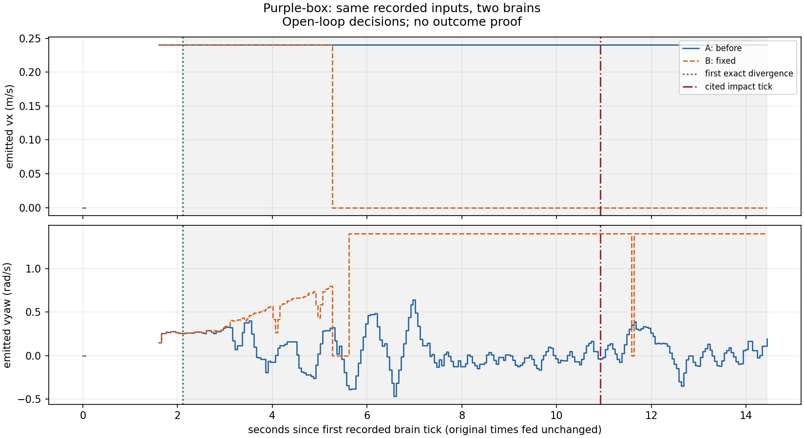

# Purple-box SIL decision comparison

This is an **open-loop decision divergence**, not an outcome proof. The recorded inputs are what the old brain saw. After the first different command the robot would have been somewhere else; later recorded inputs no longer describe the fixed brain's world. Outcome proof stays with BlinkFlow's deterministic twin.

Replay uses the **pre-existing `microduck_brain.record.replay`** mechanism (Pollen Robotics / Hugging Face Microduck ecosystem, Apache-2.0), with an observer that captures each unchanged `Brain.tick` result. New work here is the BlinkFlow adapter, divergence measurement, report and tests.

The incident recording came from the **live simulator**, not a physical robot. The same recording format supports physical-robot inputs, but no physical robot was tested here. No simulator, model API, network or key is needed for this replay.

Compared 289 ticks over 14.434077897 s. Commands differ on 236 ticks; states differ on 184 ticks. A reproduces the recorded commands with 0 mismatches at upstream's 1e-4 tolerance.

First exact command divergence: **tick 42 (zero based), t = 2.104866302 s** after the first recorded tick (original input timestamp `54904.671337092`).

| brain | command (vx m/s, vyaw rad/s) | state |
|---|---|---|
| A: before | `move 0.24, +0.255238095238095` | forward |
| B: fixed | `move 0.24, +0.255312401419819` | forward |

Equality is exact on the unrounded command kind, vx and vyaw. This first change need not be a brake or an in-place turn; the table states the command actually emitted.

For comparison, the first A/B difference exceeding upstream's 1e-4 comparison tolerance is tick 50, 2.505931416 s: A `move 0.24, +0.260952380952381`, B `move 0.24, +0.262053211099808`. This threshold does not replace the exact first divergence above.

Recorded contact: BlinkFlow's saved **base pixel reading**, video frame 132 / shot frame 90, **10.903 s** after the first brain tick. Its cited nearest log tick is **218**, displayed as 10.925 s (exact elapsed 10.925325438 s, original timestamp `54913.491796228`). The saved evidence is the source of contact; SIL does not measure it again.

The fixed brain's first different command is **8.820459136 s before the cited recorded impact tick** (8.798133698 s before the saved pixel contact). This does not establish that contact would be avoided.

Clock alignment follows BlinkFlow: subtract the log's first input timestamp for display, then match the evidence's millisecond-rounded tick to the unique original log row. Brain inputs keep their original timestamps. The nearest log tick is 0.022325438 s after pixel contact; pixel and tick lead times are therefore reported separately.

See [impact.json](impact.json) for the saved citation and source-file hashes.

The plot shows emitted vx and vyaw, not measured motion. Gaps mean command kind `none` (no new command), not zero velocity. Stops are drawn at zero. Shading after first divergence marks the portion whose recorded inputs belong to the old trajectory.

`why_B` contains an upstream safety/hold reason when available and is null otherwise. Upstream exposes no per-tick avoidance explanation; none is fabricated.

The bundled [twin sanity](twin-sanity.json) separately checks onset against the saved before/after deterministic-twin logs. It does not equate the later SIL commands with the fixed twin's later trajectory.

Inputs and source revisions: [provenance.json](provenance.json). Integrity inventory: [sha256.json](sha256.json).

Recheck offline from the repository root: `python3 -B -m blinkflow.sil.recheck examples/purple-box-sil`.
