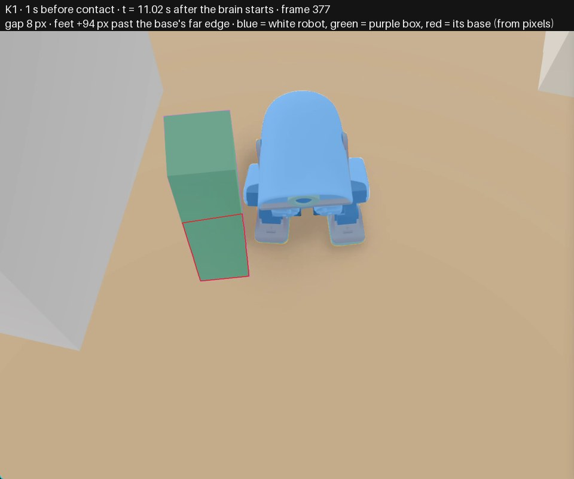
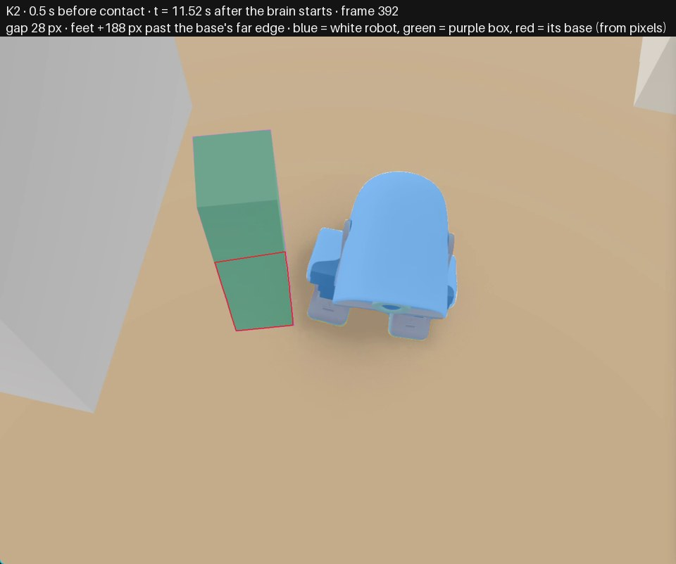
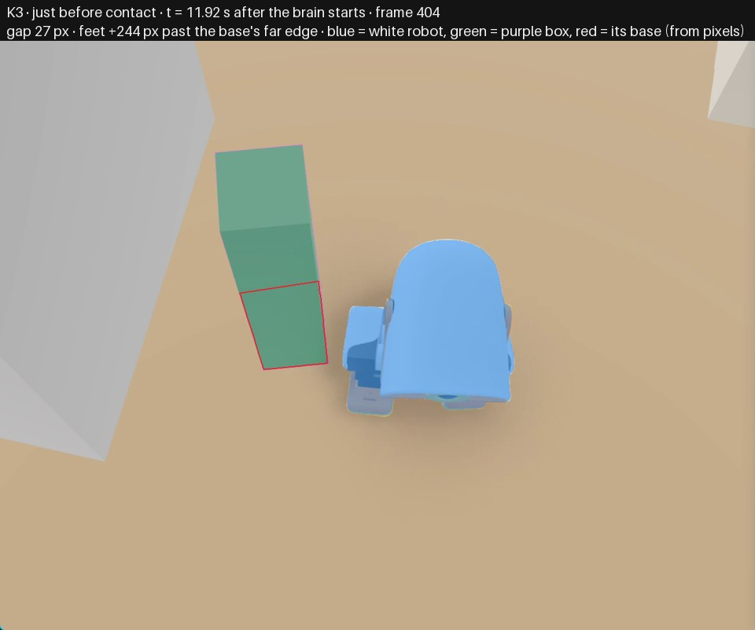
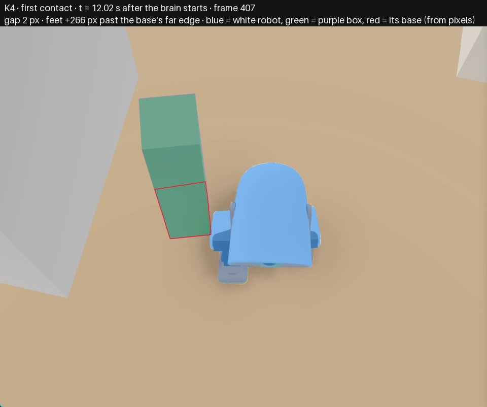

# Diagnosis: white robot touches the purple box

**Cause:** `brain.toml`, `configuration value`, lines 29-29. side_memory_seconds is set to 0.0, disabling the side-hazard memory.

**In plain words:** The robot had seen the tall box on its side while it was still ahead, but a configuration choice switched off the short memory meant for nearby side objects. Once the robot drew alongside it, the box was no longer in the forward view, so the robot believed the way was clear and kept walking until its side clipped the box.

**What happened:** Robot walked forward alongside a tall purple box and clipped it with its side at t=12.022s after approaching it from ahead-left in depth.

**Confidence:** 0.84  ·  **Fix direction (no patch):** Restore a non-zero side-memory duration in the brain configuration (matching the intended default) and add a regression check that the deployed config does not silently disable side memory.

## Evidence cited

- *frame* `K1 t=11.022s`: Purple box close to the robot's left side, slightly in front, gap 8 px. The purple box is already very close to the robot's side, slightly in front of it, while the robot is still walking forward.
- *frame* `K2 t=11.522s and K3 t=11.922s`: Box remains close beside robot as feet pass the base; gap still non-contact before K4. The robot keeps passing alongside the box with the box still close to its side; contact is a side clip, not a head-on approach.
- *frame* `K4 t=12.022s`: First contact, gap 2 px, feet 265.7 px past base edge. First contact occurs while the box is beside the robot, at gap 2 px and feet 265.7 px past the base's far edge, consistent with clipping a side object after passing its front.
- *log* `brain log t=9.045-10.498s, dt -2.977 to -1.524s`: Close left-edge wall-row depth returns before passing. Earlier full depth frames have close upper/wall-row returns on the robot's left edge, e.g. column 0 upper rows about 83/81/77/77/75 cm at t=9.045s and about 63/62/60/59/58 cm at t=10.498s, so a side wall/object return was available to be remembered before the robot passed it.
- *log* `brain log t=11.500s`: Forward/left depth view clear during passing. By the passing phase the full depth frame no longer shows that close left object in the near wall rows; column 0 wall-row values are about 150/148/146/145/147 cm, so the box is effectively outside the trusted forward view while it is beside the robot.
- *log* `brain log t=9.045-11.950s`: Always forward/move, no brake or turn. The brain stays in state=forward with cmd move vx=0.24 throughout the approach and passing; it never brakes/turns for the box before contact, even while K1-K3 show it close alongside.
- *code* `brain.toml:29`: side_memory_seconds = 0.0. The deployed configuration explicitly sets side_memory_seconds = 0.0, unlike the code default of 3.0 s in src/microduck_brain/config.py:46.
- *code* `src/microduck_brain/hazards.py:62-66 and 73-76`: _enabled(SIDE) requires >0; _memory_seconds uses same setting. Side hazards are enabled only when side_memory_seconds > 0, and that value is also the memory duration for side points; with 0.0 the side memory is disabled and cannot contribute a remembered hazard to the view.
- *code* `src/microduck_brain/hazards.py:96-107 and 173-204`: SIDE detection exists but is disabled by config. The code has a specific path that detects wall-row returns near the body and remembers them in odometry, but that path is inert when the memory is disabled in configuration.

## Ruled out

- Pure head-on wall stopping failing: The contact in K4 is beside the robot after its feet had passed the base's far edge, and by t=11.500-11.950s the forward depth view was comparatively clear; the missing protection is for a side object that was seen earlier and then passed.
- Low-object bottom-row detection being the primary cause: The purple box is tall and appears in the close upper/wall-row depth returns earlier (t=9.045-10.498s), not as a bottom-row-only cube/ball case.
- Safety hold, fall, or missing depth frames: The log shows safe=yes and continuous forward commands through the incident window; the robot was not held for a fall or missing depth.
- Corridor-width filtering in the hazard merge as the sole cause: With side memory disabled by brain.toml:29, hazards.py cannot retain SIDE points at all, so the merge threshold is not the first failing place on this evidence.

## Check against what was sent

- file exists: True; lines in range: True; function found: True
- key frames cited: K1, K2, K3, K4; log ticks cited: 9.045, 10.498, 11.022, 11.500, 11.522, 11.922, 11.950
- references that match nothing sent: none
- **grounded in pixels and log: yes**

## Key frames

**K1** 1 s before contact, t = 11.02 s. Glimmer: *The robot is walking forward with its legs lifted off the ground, and the purple box is to the left of the robot, slightly in front of it and very close to its left side.*

**K2** 0.5 s before contact, t = 11.52 s. Glimmer: *The robot is walking forward with its legs positioned under its body, and the purple box is to the left of the robot, slightly above it in the picture and close to its left side.*

**K3** just before contact, t = 11.92 s. Glimmer: *The robot is walking forward with its legs positioned behind its body, and the purple box is to the left of the robot, slightly above it in the picture and very close to its left side.*

**K4** first contact, t = 12.02 s. Glimmer: *The robot is standing still with its legs together under its body, and the purple box is to the left of the robot in the picture, slightly above it and close to its left side.*

## Model

muse-wonder-1.0 (Meta Model API), effort medium, 40826 input tokens (30182 cached), 6063 output (4753 reasoning), $0.170, 64 s. Every call of this incident is in `models.json`.
