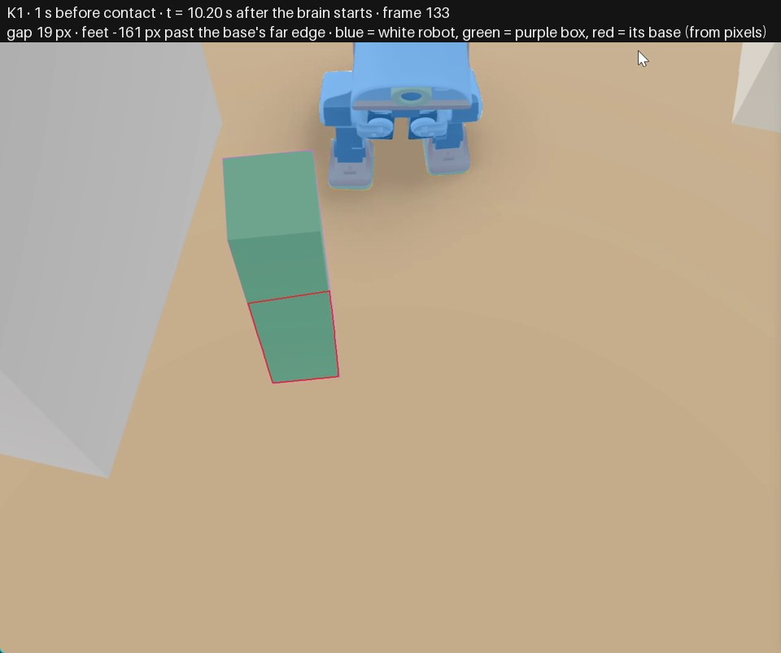
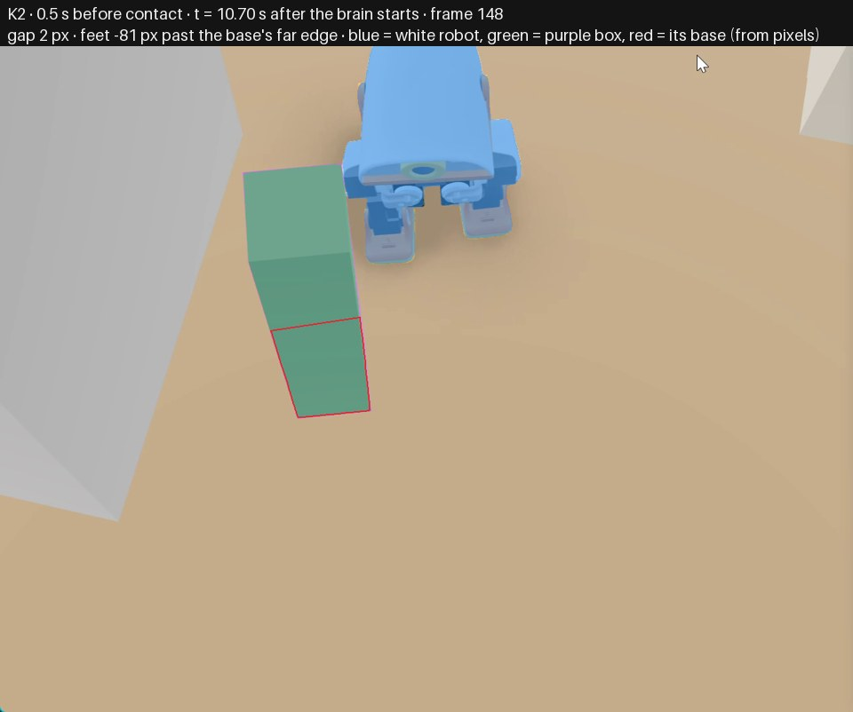
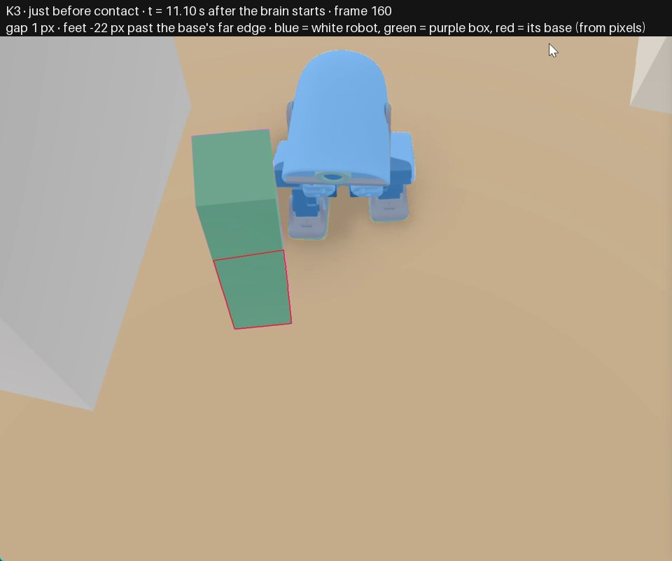
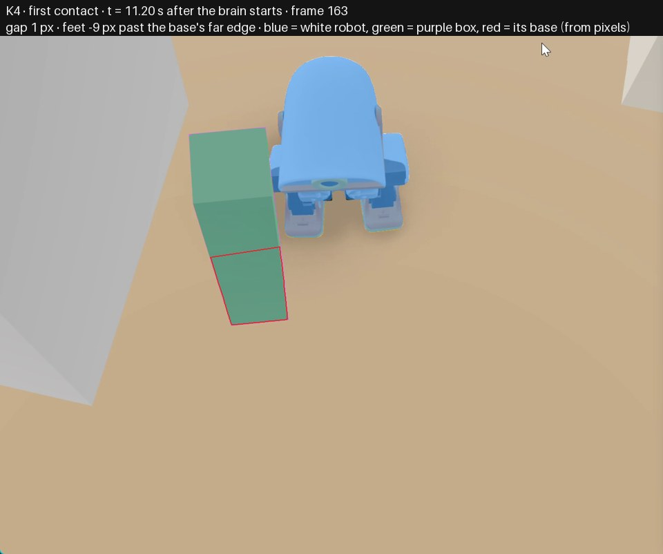

# Diagnosis: white robot touches the purple box

**Cause:** `brain.toml`, `[obstacle] side_memory_seconds`, lines 29-29. side_memory_seconds is set to 0.0, disabling the hazard memory for wall returns near the body

**In plain words:** The box approached at the very edge of the depth sensor's view, beside the robot rather than in the centre of its path, so the ordinary check of what lies directly ahead stayed clear and the robot kept walking. A separate safeguard exists that remembers nearby surfaces seen at the sides, but that memory was switched off in the settings, so those edge sightings left no trace and were never acted on.

**What happened:** The robot walked straight into the purple box that approached on its side, touching it at t=11.202 (frame 163) without ever slowing, steering away, braking or turning.

**Confidence:** 0.62  ·  **Fix direction (no patch):** Give the near-body side memory a positive retention time (as in the built-in defaults) so wall returns seen in the outer columns are kept and fed into the view ahead, then re-run this recording to confirm the robot steers or stops before the box.

## Evidence cited

- *frame* `K2, t=10.702`: gap 2.0 px, feet past base edge -81.4 px. The purple box is already touching the robot on screen at its side, while its feet are still -81.4 px from the base's far edge, i.e. this is a side/edge obstacle, not a centred obstacle straight ahead.
- *frame* `K4, t=11.202`: gap 1.0 px, feet past base edge -9.2 px. First real contact: the box is close to the robot's left side and partially in front of it, confirming contact with an object at the edge of the robot rather than in the middle of its path.
- *log* `brain log t=10.722 to t=11.424`: state=forward, cmd=move, vx=0.24 for every tick. The brain never left forward, never braked or turned, and kept commanding vx=0.24 right through contact, so the obstacle never entered the view the forward state acts on.
- *measurement* `full depth frame t=11.123`: column 0 = 109/105/101/70/68 cm in rows 0-4 vs column 1 = 126/124/117/116/116 cm. Just before contact the close object is only in the outermost left column (68-70 cm in rows 3-4, 101-109 cm in rows 0-2) while columns 1 onward are 101 cm or more; the central wall analysis therefore sees a clear way.
- *measurement* `full depth frame t=11.223`: column 0 = 67/66/63/62/63 cm vs column 1 = 112/108/107/108/108 cm. At contact the same pattern holds: column 0 reads 62-67 cm while column 1 reads 107-112 cm, so the object stayed in the edge column the whole time.
- *log* `brain log t=8.217 to t=11.424`: safe=yes on every tick, fresh frames marked '*' regularly. Depth frames kept arriving (new-frame marks throughout) and safe=yes throughout, so this was not a sensor-dropout, fall or health hold.

## Ruled out

- A centred wall obstacle that the forward/brake logic saw but handled too late: The brain stayed in forward with vx=0.24 on every tick from t=8.217 to t=11.424 and no brake/turn state ever appears; also the central columns in the full frames at t=11.123 and t=11.223 read over 1 m, never under the stop distance.
- A fall, unhealthy robot, or missing depth frames causing a hold or blindness: safe=yes on every log tick and new depth frames are marked arriving throughout, up to and past contact at t=11.202.
- A low floor-level object or a single noisy depth zone: The close return appears in the top and middle sensor rows too (rows 0-4 in column 0 at t=11.223), not only in the bottom floor rows, and it persists across frames 10.722 to 11.223 rather than flickering once.
- The central front columns (1-6) excluding column 0, on its own: The outermost-column returns would have been eligible for the side-hazard memory (within its forward and sideways band); what removed them was the zero retention setting, not the central-column window, which is a deliberate design split between the two mechanisms.

## Check against what was sent

- file exists: True; lines in range: True; function found: True
- key frames cited: K2, K4; log ticks cited: 8.217, 10.702, 10.722, 11.123, 11.202, 11.223, 11.424
- references that match nothing sent: none
- **grounded in pixels and log: yes**

## Key frames

**K1** 1 s before contact, t = 10.20 s. Glimmer: *The robot is walking forward with its legs lifted off the ground, and the purple box is to the left of the robot in the picture, slightly below and in front of it, close to its left leg.*

**K2** 0.5 s before contact, t = 10.70 s. Glimmer: *The robot is walking forward with its legs positioned under its body, and the purple box is to the left of the robot in the picture, slightly in front of it and close to its left side.*

**K3** just before contact, t = 11.10 s. Glimmer: *The robot is walking forward with its orange feet on the ground and its legs slightly apart, and the purple box is to the left of the robot in the picture, close to its front left side, appearing slightly in front of and to the left of the robot’s body.*

**K4** first contact, t = 11.20 s. Glimmer: *The robot is standing facing the camera with its orange feet on the ground and its legs slightly apart, and the purple box is to the left of the robot in the picture, close to its left side and partially in front of it.*

## Model

muse-wonder-1.0 (Meta Model API), effort medium, 41259 input tokens (30182 cached), 9102 output (7925 reasoning), $0.232, 120 s. Every call of this incident is in `models.json`.
