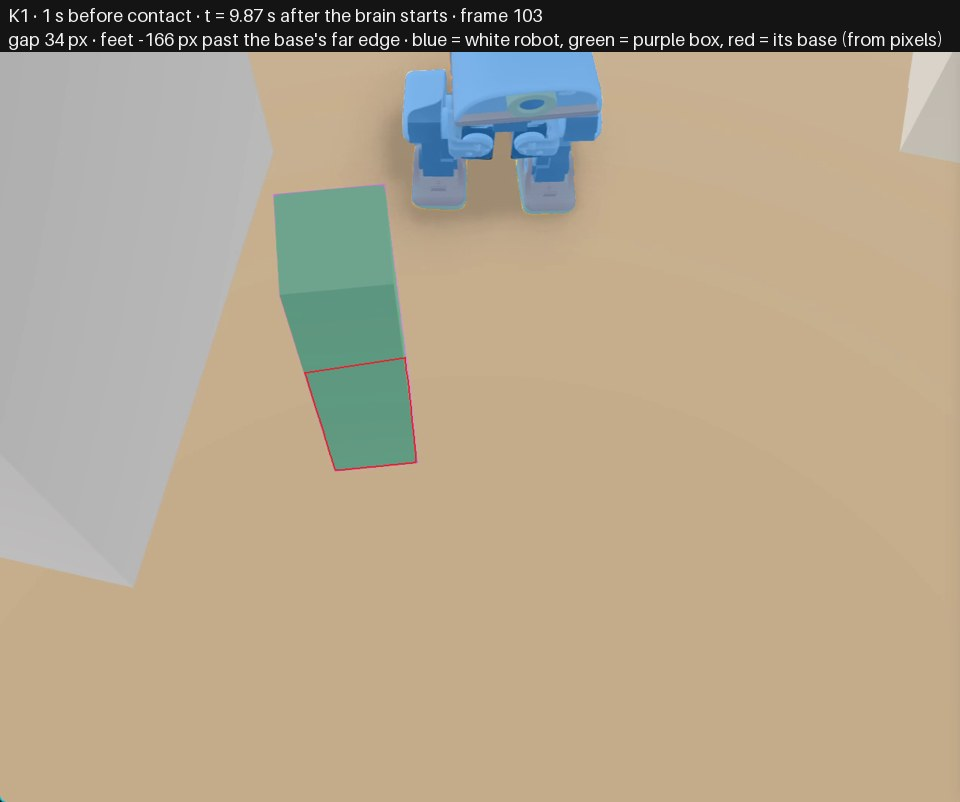
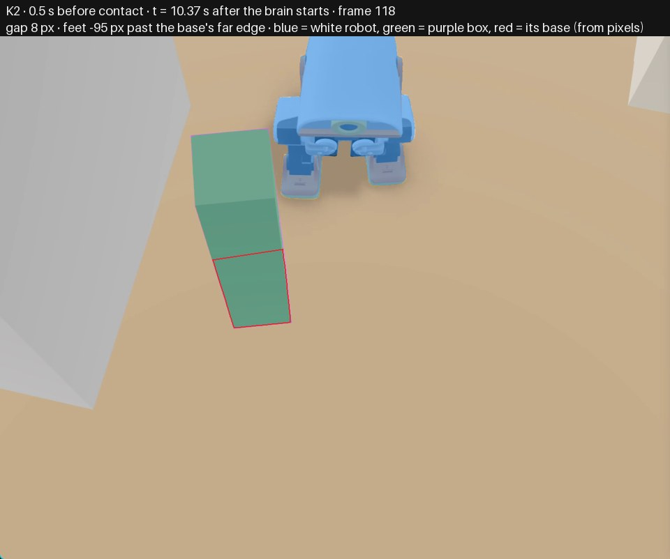
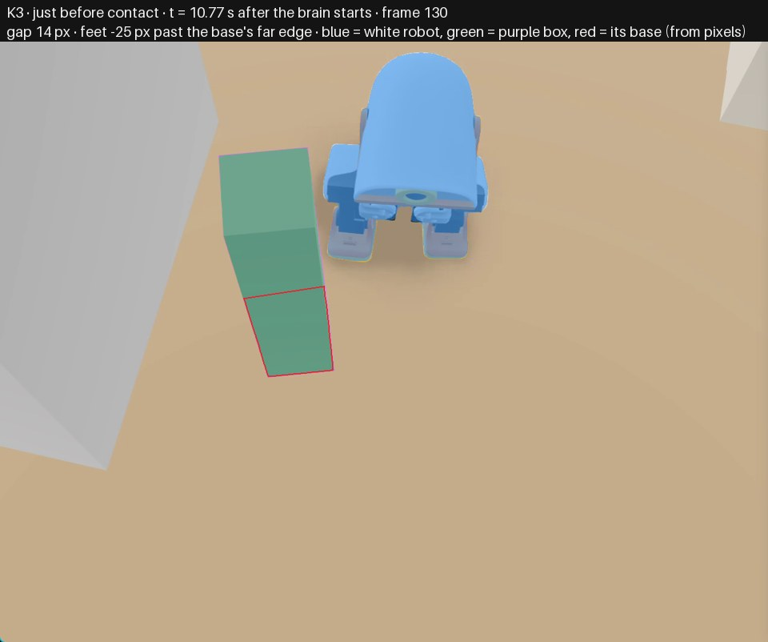
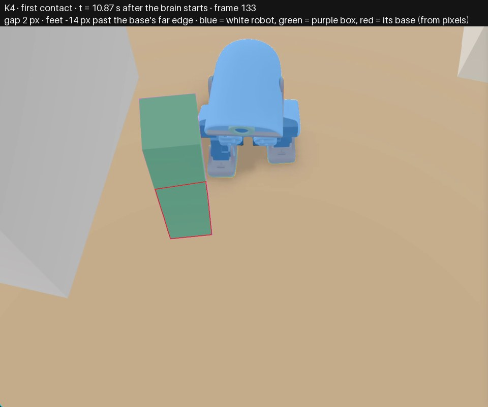

# Diagnosis: white robot touches the purple box

**Cause:** `brain.toml`, `obstacle.side_memory_seconds`, lines 29-29. The time for remembering wall returns near the robot's side is set to zero, so side hazards are never retained once they leave the current central view.

**In plain words:** The box was beside the robot rather than squarely ahead, so as the robot drew level with it the box slipped out of the sensor's central view and the way ahead looked clear. Because remembering nearby side obstacles was switched off, the robot forgot the close obstacle it had seen at its side and kept walking straight until it touched the box.

**What happened:** Robot walking forward in K1-K3 with the purple box close to its side, then touching it in K4, while the brain log stays in forward with vx=0.24 throughout.

**Confidence:** 0.78  ·  **Fix direction (no patch):** Restore a positive remembering time for near-body wall returns in the configuration (for example the built-in few seconds), so a side obstacle seen shortly before it leaves the view still steers or stops the robot while it passes.

## Evidence cited

- *frame* `K1 t=9.869`: gap 34.0 px, feet -166.3 px past the base edge. The purple box is already close beside the robot, not directly in its central path.
- *frame* `K2 t=10.369`: gap 8.2 px. The box remains beside the robot's leg as it keeps walking.
- *frame* `K4 t=10.869`: gap 2.0 px. First contact with the box beside the robot's front.
- *log* `log t=10.775`: dt=-0.094, state=forward. Just before contact the brain is still in forward, commanding vx=0.24 and only vyaw=+0.050; it never brakes or turns away.
- *log* `depth t=10.775`: rows 0-4, cols 1-6 all >= about 124 cm. The central wall rows contain no near obstacle: the closest central-column returns are about 1.24 m, above both the 0.70 m steering distance and 0.28 m stop distance, so the current front view alone looks clear while the box is at the side.
- *log* `depth t=7.918`: cols 0-3 rows 0-4 approx 62-97 cm. Earlier the sensor did register close returns on one side, around 0.62-0.89 m in the left-hand columns while the opposite side reached about 2.9 m; those are the kind of near-body wall returns that side memory exists to retain.

## Ruled out

- Safety hold, fall detection or missing depth stopping it too late: Every log tick from t=7.918 to t=11.076 says safe=yes and stays in forward, and the robot visibly walks in K1-K3.
- Sensor blindness or a blind-frame false clear: At t=9.873, t=10.374 and t=10.775 the central rows have many valid returns and no near central obstacle; there is no blind-frame signature, and the state never leaves forward.
- Failure to brake after the front view reported an obstacle: At t=10.775 the central wall distances are roughly 1.24 m or more, far beyond the stop threshold, so a correctly triggered brake or turn state would have appeared in the log; none does.
- Commanded walking speed below the stepping threshold: The log shows repeated commanded forward motion at 0.24 and the camera shows the robot actually advancing toward the box in K1-K4; this was not a stationary threshold failure.
- Low-object or drop handling in the bottom rows as the primary failure: The contact in K4 is at the robot's side and the near hazard is absent from the central front columns in the t=10.775 frame, which matches a side obstacle lost from view rather than a low object or drop straight ahead in the bottom rows.

## Check against what was sent

- file exists: True; lines in range: True; function found: True
- key frames cited: K1, K2, K4; log ticks cited: 7.918, 9.869, 10.369, 10.775, 10.869
- references that match nothing sent: none
- **grounded (file, lines and function real; key frames and log ticks cited that exist): yes**

## Key frames

**K1** 1 s before contact, t = 9.87 s. Glimmer: *The robot is walking forward with its legs apart and its feet on the ground, and the purple box is to the left of the robot in the picture, slightly below and in front of it, close to the robot’s left side.*

**K2** 0.5 s before contact, t = 10.37 s. Glimmer: *The robot is walking forward with its legs positioned under its body, and the purple box is to the left of the robot, slightly in front of it and close to its left leg.*

**K3** just before contact, t = 10.77 s. Glimmer: *The robot is walking forward toward the camera with its legs lifted off the ground, and the purple box is to the left of the robot in the picture, slightly in front of it and close to its left side.*

**K4** first contact, t = 10.87 s. Glimmer: *The robot is standing with its legs together and slightly bent, and the purple box is to the left of the robot in the picture, close to its front left side.*

## Model

muse-wonder-1.0 (Meta Model API), effort medium, 41158 input tokens (30310 cached), 7708 output (6666 reasoning), $0.204, 63 s. Every call of this incident is in `models.json`.
