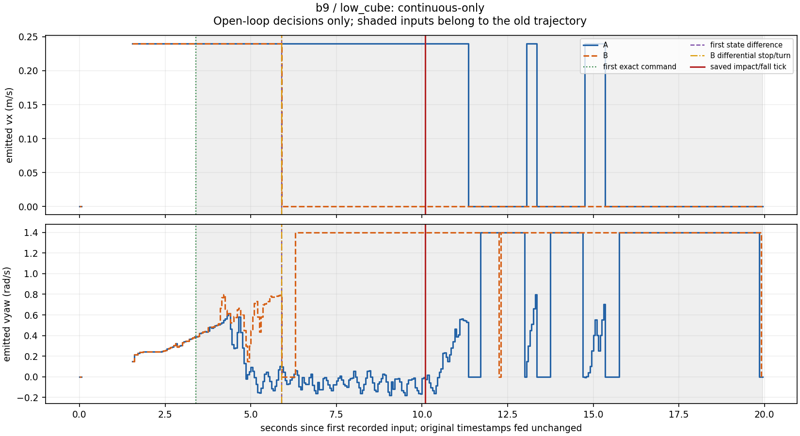

# b9 — low_cube SIL

**Open-loop decision divergence, not an outcome proof.** Recorded inputs belong to the buggy brain. After its first different command, the fixed robot would be elsewhere and later inputs no longer describe its world. Outcome proof stays with BlinkFlow's deterministic twin; no physical robot was tested.

Uses unchanged, pre-existing `microduck_brain.record.replay` (Pollen Robotics / Hugging Face Microduck ecosystem, Apache-2.0) with the Phase 1 observer. New work is the adapter, measurements, classification, report and tests.

Class: **continuous-only**. Continuous-only (inconclusive): later state/stop differences are outside the shared prefix and cannot establish the fixed trajectory.

Kept fix (attempt 1): restore low-object forward/lateral components. The exact saved patch is [change.diff](change.diff). Source revisions and hashes are in [case.json](case.json).

Saved pixel **contact**, reading `base`, frame 375: elapsed 10.125000 s. Nearest impact tick 202: elapsed 10.100000 s, original timestamp 13.1. Matched the tick explicitly cited by saved contact evidence. Tick minus pixel-event time: -0.025000 s.

The selected saved event excerpt is in [event.json](event.json); its original evidence-file path and SHA-256 are recorded. `pixel_contact_elapsed_s` is the legacy Phase 1 compatibility key and denotes the selected pixel **fall** when event_kind is fall. No fall is relabelled as a contact.

| measurement | elapsed time / tick | A state → B state | commands A / B (vx m/s, vyaw rad/s) | lead to cited impact tick / saved pixel event | shared prefix |
|---|---|---|---|---|---|
| First exact divergence | 3.400000 s (tick 68) | forward → forward | `move 0.24, +0.3866159608785901` / `move 0.24, +0.3888235294203159` | 6.700000 / 6.725000 s | yes |
| First state divergence | 5.900000 s (tick 118) | forward → brake | `move 0.24, +0.09652619232704245` / `stop 0.0, +0.0` | 4.200000 / 4.225000 s | no: after first command divergence |
| B first stop/turn, including startup | 0.000000 s (tick 0) | hold → hold | `stop 0.0, +0.0` / `stop 0.0, +0.0` | 10.100000 / 10.125000 s | yes |
| B first stop/turn after entering forward | 5.900000 s (tick 118) | forward → brake | `move 0.24, +0.09652619232704245` / `stop 0.0, +0.0` | 4.200000 / 4.225000 s | no: after first command divergence |
| B first differential stop/turn while A forward | 5.900000 s (tick 118) | forward → brake | `move 0.24, +0.09652619232704245` / `stop 0.0, +0.0` | 4.200000 / 4.225000 s | no: after first command divergence |

Classify on the prefix ending at the first exact different command. discrete-decision-before-impact requires a pre-impact first different command and B's differential stop/in-place turn or protective state while A stays forward, with no earlier different command. Earlier continuous steering makes the result continuous-only (inconclusive), even if a later state differs before impact. Without a command difference strictly before the cited impact tick, classify no-divergence-before-impact. No numerical threshold replaces exact equality.

The initial shared startup stop is not a differential decision. A turn means `move` with vx=0 and nonzero vyaw; steering with vx>0 stays continuous. All comparisons use exact unrounded command values, without tuning a threshold.

Ticks: 400; exact command differences: 196; state differences: 186. A matches the saved commands at upstream's 1e-4 recording tolerance and all saved states. `why_B` is only the upstream safety/hold reason; no avoidance explanation is invented.

Traces show emitted commands, not observed motion. Gaps represent `none`. Shading starts at exact divergence; later state/command markers are retained without claiming their later inputs are counterfactual reality.

Offline recheck: `python3 -B -m blinkflow.sil.recheck examples/suite-sil`. No API, simulator, installation, key file or network is needed; cost $0.
